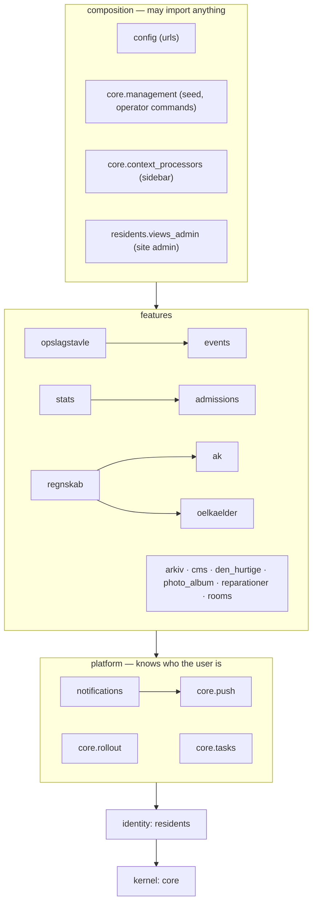

# Domain boundaries

GAHK Intern is a **modular monolith**: one Django project, one deployment, one PostgreSQL database —
and inside it, Django apps that each **own their data and their rules**. A domain's models, queries
and services are private. Other domains talk to it only through its public `api.py`: commands,
queries and events that carry ids and DTOs, never model instances.

The goal is encapsulation at the level of a domain — the same thing a class does for its fields —
so that a business rule is enforced in one place, and a domain can be refactored without searching
the whole codebase for who else reads its tables.

Run the checks locally with `task boundaries`. CI runs the same checks on every pull request
(`.github/workflows/boundaries.yml`).

## The map



| Layer | Modules | May import |
|---|---|---|
| composition | `config`, `core.management`, `core.context_processors`, `residents.views_admin`, `residents.urls_admin` | anything, including internals. Wiring and operator tooling only, never business rules. |
| features | `admissions`, `ak`, `arkiv`, `cms`, `den_hurtige`, `events`, `oelkaelder`, `opslagstavle`, `photo_album`, `regnskab`, `reparationer`, `rooms`, `stats` | the `api` of the layers below; a sibling feature's `api` only if `tach.toml` lists it in `depends_on` |
| platform | `notifications`, `core.push`, `core.rollout`, `core.tasks` | the rest of platform (`notifications` only via its `api`), identity's `api`, kernel |
| identity | `residents` | kernel |
| kernel | `core` (everything else in it) | nothing above it |

The arrows between features are deliberately few, and each one is in `tach.toml` with a comment
saying why. Adding one is a design decision, so it shows up in review as a diff to that file.

## Inside a domain

```
app/<domain>/
    api.py        PUBLIC — the only module other domains may import
    handlers.py   subscriptions to other domains' events, registrations into their extension points
    apps.py       ready() imports handlers.py
    models.py     private
    services.py   private
    views.py …    private
```

`api.py` holds four kinds of things:

| Kind | Shape | Example |
|---|---|---|
| **Query** | function → DTO, primitive, or a lazy queryset of **ids** | `events.api.event_summaries(ids) -> dict[int, EventSummary]` |
| **Command** | function that changes this domain's state and enforces its invariants | `residents.api.place_on_roster(resident_id, period, room_id)` |
| **Event** | frozen dataclass of ids and primitives, subclassing `core.domain_events.DomainEvent` | `residents.api.MemberAreaVisited(resident_id, year, month)` |
| **Extension point** | a `register_…` function for "show me your content about X" | `events.api.register_mention_provider(provider)`, `residents.api.register_dashboard_card(provider)` |

DTOs are frozen dataclasses. Returning a model instance is what the rule exists to prevent: whoever
receives it can read every relation on it and call `.save()`.

An **id subquery** is allowed to cross a boundary (`residents.api.roster_resident_ids()` returns
`values_list("resident_id")`). It is not a model instance, and it lets the caller keep its
`filter(user_id__in=…)` as a single SQL statement instead of a round trip.

## Talking to another domain

**Ask for data → query.** `opslagstavle` shows an event chip on a post. It stores `event_id` and asks
`events.api.event_summaries(...)` for one batch of `EventSummary` DTOs per page.
(`opslagstavle/views.py: _decorate`)

**Change another domain's data → its command.** `rooms` ends a room-allocation round, which moves
residents between rooms on next month's roster. The roster belongs to identity, so `rooms` calls
`residents.api.carry_roster_forward`, `place_on_roster` and `remove_from_roster`. It used to write
`Residency` and `RoleAssignment` rows itself.

**Something happened, and someone else cares → event.** Opening the member dashboard is AK's cue to
charge the month that just ended if the cron job missed it. `residents` publishes `MemberAreaVisited`;
`ak/handlers.py` subscribes. Identity no longer imports AK, and doesn't know AK exists.

```python
# residents/api.py — the publisher defines the event; it is part of its contract
@dataclass(frozen=True)
class MemberAreaVisited(domain_events.DomainEvent):
    resident_id: int
    year: int
    month: int

# residents/views.py
domain_events.publish(MemberAreaVisited(resident_id=..., year=year, month=month))

# ak/handlers.py — imported from AkConfig.ready()
@subscribe(MemberAreaVisited)
def book_monthly_charge_backstop(event: MemberAreaVisited) -> None:
    ensure_previous_month_charged()
```

Handlers run **after the publisher's transaction commits** (`transaction.on_commit`, `robust=True`).
They never act on a change that was rolled back, and they can't fail the publisher's request. In
tests, wrap the code in `django_capture_on_commit_callbacks(execute=True)`. The bus is in-process
and not durable: if a handler's work must survive a crash, the handler enqueues a Celery task.

**"Show other domains' content on my page" → extension point.** The event page lists the board
posts that announce it. Querying `opslagstavle` from `events` would create an import cycle, since
the board already depends on events. Instead `events.api` offers `register_mention_provider`;
`opslagstavle/handlers.py` registers one, and the event page renders whatever sections come back.
The dependency now points one way only.

The same inversion is how a lower layer shows a feature's content, since it may not import one at
all. The member dashboard is identity's page, and its "Begivenheder på GAHK" card is begivenheder's:
`residents.api` offers `register_dashboard_card`, and `events/handlers.py` registers a provider that
renders the card. Likewise Den Hurtige's one-notification-category-per-room: `den_hurtige/handlers.py`
hands them to `notifications.api.register_categories`, where `notifications` used to import the
channel registry to build them.

**Tell a resident something → `notifications.api`.** In-app and push notifications are platform,
below every feature. A feature decides the audience and the wording and calls
`notifications.api.notify(...)` (or `notify_grouped` for "Anders og Bente svarede"); notifications
decides the rest from each resident's settings. `notifications` imports no feature: its demo rows
get their links to seeded events, posts and messages from `seed_demo`, which is composition.

**A report across domains → its own module.** `regnskab`, the settlement of a moved-out resident,
combines who moved out (identity), the AK balance and the ølkælder balance. It owns no data, so it
is a small feature module that reads all three APIs. It doesn't belong inside any one of them.

## Identity is the shared reference

Every domain needs to know who someone is. `residents.api` therefore exports `Resident` itself. It's
`AUTH_USER_MODEL`, Django already passes one to every view as `request.user`, and every domain holds
a ForeignKey to it. Use it as a reference: for annotations, FK targets (`settings.AUTH_USER_MODEL`)
and reading a name or email.

Changing identity data (a resident, their roster rows, their roles) goes through `residents.api`
commands. `Residency`, `RoleAssignment` and `AdminAccessGrant` are private. "Who lives here this
month", "who holds role X" and "which workgroup is she in" are queries in `residents.api`.

## What is enforced, and what is not

The honest part. Static analysis sees **imports**. Django's ORM moves data between domains through
paths that involve no import at all.

| Rule | How it's enforced | Where |
|---|---|---|
| Import another domain only via its `api` | **CI** — Tach interfaces | `tach.toml` |
| Sibling features only along declared arrows | **CI** — Tach `depends_on`, with `exact = true` so unused entries fail too | `tach.toml` |
| No upward imports, no cycles | **CI** — Tach `layers`, `forbid_circular_dependencies` | `tach.toml` |
| Function-local (lazy) imports | **CI** — Tach sees them like any other import | |
| Annotation-only imports under `TYPE_CHECKING` | Allowed on purpose (`ignore_type_checking_imports`) | |
| A cross-domain FK must not leave a reverse accessor (`resident.ak_entries`, `event.notices`) | **CI** — Django system check `core.E010`/`E011`, against a shrinking baseline | `core/boundaries.py` |
| No raw SQL outside operator code | **CI**, partially: ruff bans importing `django.db.connection(s)` and `RawSQL` outside an allow-list (the workflow's `raw-sql` job, and `lint`) | `app/ruff.toml` |
| `.raw()` / `.extra()` on a manager | **Review only.** No import to catch | |
| Following a **forward** FK into another domain (`notice.event.title`) | **Review only.** The owning side needs the FK; the accessor comes with it. Read `event_id` and ask the other domain's `api` | |
| `__` lookups across domains (`Notice.objects.filter(event__visibility=…)`) | **Review only.** It compiles to a join, with no import | |
| Mutating a `Resident` (or any instance) somebody handed you | **Review only.** Tach can't see `.save()` | |
| `apps.get_model("ak", "AkEntry")`, `import_string(...)` | **Review only.** String references are invisible to import analysis | |
| Celery task names, URL names (``), template variables | **Review only.** Strings and templates aren't Python imports | |
| Cascades: `on_delete=SET_NULL/CASCADE` | Not a violation, but know this: Django emulates them **in Python**, so deleting an `Event` makes `events`' code issue the `UPDATE` on `opslagstavle_notice` | |
| Tests | Excluded. Tests may reach into internals | |

So: **the checks prevent accidental coupling, and review catches the deliberate kind.** The table
above is the review checklist.

Why not stronger runtime isolation? Separate PostgreSQL schemas and a database role per domain would
make the database refuse cross-domain reads. But Django uses one connection for the whole process,
so every domain would run as the same role anyway, and it would cost the cross-domain foreign keys
that make a single database worth having. Microservices would buy real isolation at the price of
network calls, distributed transactions and a second deployment, which a kollegium intranet
doesn't need.

## When the rules are in the way

* **You need data from another domain that its `api` doesn't offer:** add a query to *its* `api.py`
  in the same PR. That is the intended path, not a workaround.
* **A feature genuinely depends on a sibling:** add it to that module's `depends_on` in `tach.toml`
  with a comment saying why. If Tach then reports a cycle, invert one direction with an event or an
  extension point.
* **Truly a one-off:** `# tach-ignore(reason) path.to.thing` on the import line. A reason is
  required, and an ignore that no longer suppresses anything fails the check
  (`[rules]` in `tach.toml`). `grep -rn tach-ignore app` is the debt list. There are none today.
* **A new cross-domain FK:** `related_name="+"`. Don't add it to `BASELINE`.

## Known debt

Burn these down opportunistically, one PR at a time:

1. **`core.boundaries.BASELINE`**: 39 cross-domain relations that still create reverse accessors,
   almost all `FK → Resident` (`resident.notices`, `resident.shopper_accounts`, …). Each fix is
   `related_name="+"`, a migration with no SQL, and moving any user of the accessor to an `api` call.
   `opslagstavle.Notice.event` is the worked example.
2. **`core.models` holds domain models**: `Room`, `Workgroup` and `Cleaning` are identity/rooms
   concepts living in the kernel for legacy reasons. Moving them means a `SeparateDatabaseAndState`
   migration.
3. **`Resident` is exported as a model**, not a DTO (see *Identity*). Feature code that runs
   `Resident.objects…` at runtime could move to `residents.api` queries over time.
4. **The composition layer can see everything.** `seed_demo`, `audit_media` and the site-admin
   worker-jobs page use other domains' models directly. That's acceptable for operator tooling,
   but the composition `[[interfaces]]` block could be narrowed per module.
